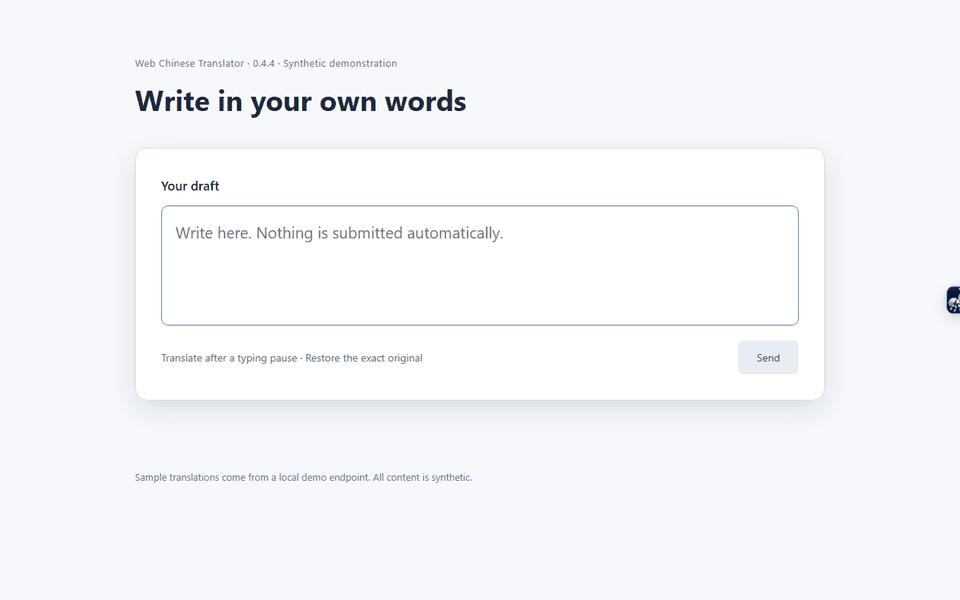

<h1 align="center">
  <br>
  Web Chinese Translator
</h1>
<p align="center"><a href="README.md">简体中文</a> · English</p>

<p align="center">
  Translate webpages and drafts with your own model endpoint<br>
  <sub>Read translations in place, replace drafts in the same field, and use offline UI dictionaries for GitHub and popular sites.</sub>
</p>

<p align="center">
  <a href="https://github.com/s-silt/web-chinese-translator/actions/workflows/ci.yml"></a>
  <a href="https://github.com/s-silt/web-chinese-translator/releases/latest">Latest Release</a> &nbsp;·&nbsp; <a href="https://chromewebstore.google.com/detail/gbjmhoaejahffdnefecjfgkoifggpdhe">Chrome Web Store</a> &nbsp;·&nbsp; Chrome (MV3)&nbsp;·&nbsp; <a href="LICENSE">MIT</a>
</p>

## Feature demos



[View all demos and screenshots](docs/DEMOS.en.md)
Input translation replaces drafts after a typing pause. Restore original uses an exact draft temporarily saved in local memory. Video subtitle translation has been removed.

| Core Capability | Description |
| --- | --- |
| **Webpage translation** | Connect an OpenAI-compatible endpoint (DeepSeek, OpenAI, Claude, or a self-hosted relay) for full-page or per-site automatic translation as you scroll |
| **Reading & input** | Selection translation and definitions, multilingual draft translation for chat input fields and web search boxes |
| **Offline UI dictionaries** | Menus and buttons on 26 popular site groups (Cursor, Claude, Vercel, Linear, etc.) and GitHub are replaced locally without calling a model |
| **Controllable** | Master switch, Exclude this site, per-page limit, and Where to run list; status and failure reasons are shown directly in the popup |

```text
Page text ──► Authorized site + Configured endpoint ──► Your model endpoint ──► In-place replacement    Sent on demand
    │                         │
    │         Sensitive pages skip automatic processing. Excluded sites disable model features. Incognito is unsupported.
    │
    └──► UI dictionaries (popular sites / GitHub / custom) ──► In-place replacement        Offline
```

## Quick Start

1. Recommended: install on Chrome from the [Chrome Web Store](https://chromewebstore.google.com/detail/gbjmhoaejahffdnefecjfgkoifggpdhe) for automatic updates.
2. [Releases](https://github.com/s-silt/web-chinese-translator/releases/latest) only provides `web-chinese-translator-<version>-chrome.crx` and the `SHA256SUMS.txt` checksum file. The CRX package is intended for environments that permit self-hosted extension installation (such as enterprise policy, Linux, or development/testing setups; standard Chrome on Windows and macOS typically restricts sideloading CRX files); regular users should install from the Chrome Web Store.
3. Click "Configure model" or "Model settings" in the popup: choose a provider preset, enter your API Key and model name, and click "Save & connect". The connection badge shows latency or the reason for failure.
4. Open a supported English webpage and click "Translate this page" in the popup. Enable "Auto-translate this site" for sites you visit often.

| Task | Entry Point |
| --- | --- |
| Translate or restore the current page | Main button in the popup, or `Alt+T` |
| Always auto-translate a site | "Auto-translate this site" in the popup |
| Never call a model on a site | "Exclude this site" in the popup (local dictionaries still work) |
| Translate selected text | Select text and right-click "Translate selected text", or press `Alt+S` |
| Translate drafts in input fields or search boxes | Enable Input translation and grant access; drafts are replaced after the configured typing pause. Restore original recovers the saved draft. No input shortcut or automatic message sending |
| Translate an online document editor | Enable Input translation and grant access; supported safe plain text is replaced after typing stops, while complex formatting offers preview and copy only |
| Paste arbitrary text or Markdown | Use Text translation in the popup or webpage floating menu, up to 6000 characters per request; it reuses the existing model configuration and does not restore drafts after the window closes |
| Long article stops translating midway | Raise "Per-page limit" in Settings, or click "Resume translation" |
| Add or override UI dictionary entries | "Sites & dictionaries" in Settings; for GitHub, use "GitHub rules" |
| Full documentation | [Usage Guide](docs/USAGE.md) (Chinese) |

In-place replacement is currently unsupported in Word for the web and desktop Word; use the text translation window to paste text instead. Editor compatibility depends on the version and document structure. Restoration checks current content and does not overwrite newer drafts with an old replacement record.

## Default Behavior & Boundaries

- **Model translation is off by default.** Provider endpoint presets are available, but you configure the endpoint and supply your own credentials. Webpage features send content only on enabled, authorized sites; the text window sends typed or pasted text only when you request a translation. Charges are governed by your agreement with the provider.
- **Per-page limit.** Defaults to about 50,000 characters per page, adjustable in Settings from 20,000 to 200,000 or Unlimited; once reached, remaining content stays in the original language.
- **UI dictionaries work offline.** UI entries for popular sites and GitHub are replaced locally; the GitHub dictionary includes both Simplified and Traditional Chinese sets—see [Usage Guide](docs/USAGE.md#github-汉化) (Chinese).
- **Sensitive pages are skipped.** Account, payment, mail, and similar pages are not auto-translated, and the popup displays "Skipped"; detection is heuristic and does not guarantee full coverage.
- **API Key is stored locally in plaintext.** Stored in the extension's IndexedDB, bound to the endpoint origin, and never synced with your browser account.
- **Not processed.** Cross-origin iframes, closed Shadow DOMs, and image subtitles; the extension does not run in incognito windows.

For permissions, data handling, and network requests, see the [Privacy Policy](docs/PRIVACY.en.md).

## Development

```bash
bun install
bun run lint && bun run compile && bun run check:parity && bun run check:locale && bun run test
bun run build      # Load .output/chrome-mv3
```

Requires Bun 1.3+ and Node.js 22.13+. Read the [Glossary](docs/GLOSSARY.md) (Chinese) before editing dictionaries and keep Simplified and Traditional Chinese in sync. See [Development & Release](docs/DEVELOPMENT.md) (Chinese) for details. Report issues via [Issues](https://github.com/s-silt/web-chinese-translator/issues/new/choose).

## Credits & License

Terminology references [GitHub Official Chinese Docs](https://docs.github.com/zh) and [Pro Git (Chinese Edition)](https://git-scm.com/book/zh/v2). [MIT](LICENSE) © 2026 github-chinese contributors, web-chinese-translator contributors; third-party notices are in [THIRD_PARTY_NOTICES.txt](public/THIRD_PARTY_NOTICES.txt).
