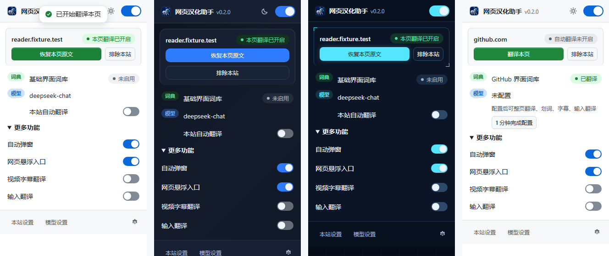

<h1 align="center">
  <br>
  网页汉化助手
</h1>

<p align="center">
  GitHub 与常用网站的界面汉化，加上可选的自定义模型翻译<br>
  <sub>本地词典离线替换界面文字；模型翻译只在你配置接口并逐站授权后发送内容。基于 <a href="https://github.com/setube/github-chinese">github-chinese</a>（MIT）。</sub>
</p>

<p align="center">
  <a href="https://github.com/s-silt/web-chinese-translator/actions/workflows/ci.yml"></a>
  <a href="https://github.com/s-silt/web-chinese-translator/releases/latest">最新版本</a> &nbsp;·&nbsp; Chrome / Edge（MV3）&nbsp;·&nbsp; Firefox 140+（仅 GitHub 汉化）&nbsp;·&nbsp; <a href="LICENSE">MIT</a>
</p>

<p align="center"></p>

| 核心能力 | 说明 |
| --- | --- |
| **GitHub 汉化** | 简体、繁体两套词典各 3 万余条，按页面类型匹配；繁体按台港澳用语从英文翻译，不做简繁转换 |
| **站点词典** | 26 组预置站点（Devin、Cursor、Claude、Vercel、Linear 等）离线替换界面词条，支持简中、繁中、日、韩；可自建词典 |
| **模型翻译** | 接入你自己的 OpenAI 兼容接口：整页翻译、站点自动翻译、划词与阅读辅助、视频字幕、输入框翻译 |
| **可控** | 总开关、排除本站、排除路径、运行范围名单；状态、失败原因和不可用原因写在弹出页上 |

```text
页面文字 ──► 本地词典（GitHub / 站点 / 自定义）──► 原位替换        不联网
    │
    └──► 已授权站点 + 已配置接口 ──► 你的模型接口 ──► 原位替换    按需发送
                     │
          敏感页面、排除网站、无痕窗口：不发送
```

只翻译界面，不碰用户内容：自述文件、评论、代码、提交消息、存储库名、用户名保持原文。

## 快速开始

1. 从 [Releases](https://github.com/s-silt/web-chinese-translator/releases/latest) 下载 `web-chinese-translator-<版本>-chrome.zip` 并解压。
2. 打开 `chrome://extensions`，开启「开发者模式」，「加载已解压的扩展程序」，选择解压出的文件夹。
3. 打开任意 GitHub 页面即生效，无需刷新。

要用模型翻译：点弹出页「1 分钟完成配置」，选服务商预设、填 API Key 和模型名，点「保存并连接」。连接徽章显示结果和延迟，失败时写明原因（密钥无效、超时、无法连接等）。

| 浏览器 | 文件 | 加载 |
| --- | --- | --- |
| Chrome | `-chrome.zip` | `chrome://extensions` → 开发者模式 → 加载已解压的扩展程序 |
| Edge | `-edge.zip` | `edge://extensions` → 开发人员模式 → 加载解压缩的扩展 |
| Firefox | `-firefox.xpi` 或 `-firefox.zip` | 安装已签名 xpi；zip 可在 `about:debugging` 临时载入，重启失效 |

更新时保持原目录，替换文件后在扩展页点「重新加载」；换目录或改用 CRX 会改变扩展身份，配置不会迁移。发布页附 `SHA256SUMS.txt`，安装前可用 `sha256sum -c --ignore-missing SHA256SUMS.txt` 核对。从源码构建：`bun install && bun run build`，加载 `.output/chrome-mv3`。

| 任务 | 入口 |
| --- | --- |
| 翻译或恢复当前页 | 弹出页主按钮，或 `Alt+T` |
| 某个网站一直自动翻译 | 弹出页「本站自动翻译」 |
| 某个网站不调用模型 | 弹出页「排除本站」（本地词典仍生效） |
| 翻译选中文字 | 选中后右键「翻译选中文字」，或 `Alt+S` |
| 翻译输入框草稿 | 设置页开启「输入翻译」，`Alt+Y` 替换（macOS `Command+Shift+Y`） |
| GitHub 某些路径不汉化 | 设置页「GitHub 规则」→ 排除路径 |
| 补充或改写词条 | GitHub：自定义词条；其他网站：设置页「网站与词典」新建词典 |
| 完整说明 | [使用说明](docs/USAGE.md) · [隐私说明](docs/PRIVACY.md) |

## 默认行为与边界

- **模型翻译默认关闭。** 扩展不内置任何模型地址或密钥。配置接口后，内容只在你开启的功能和授权的站点上发送给该接口；费用由你与接口服务方约定。
- **本地词典不联网。** GitHub 汉化和站点词典在本机匹配替换，不调用模型。
- **敏感页面跳过。** 账户、密钥、付款、邮件等页面（含哈希路由与私有网络地址）不自动翻译、不弹划词，弹出页显示「已跳过」；仅显式右键菜单可发送所选文字。识别是启发式的，不保证覆盖全部隐私页面。
- **API Key 明文存本机。** 保存在扩展的 IndexedDB，与接口来源绑定，不随浏览器账号同步，未加密。
- **单页有发送上限。** 失败段保留原文，可在弹出页重试；连续失败会暂停本页，点「继续翻译」恢复。
- **不处理的范围。** 跨域 iframe、关闭的 Shadow DOM、图像字幕不翻译；无痕窗口中扩展不运行；Firefox 版只做 GitHub 汉化。

权限逐项用途、数据保留与网络请求见 [隐私说明](docs/PRIVACY.md)。

## 开发

```bash
bun install
bun run lint && bun run compile && bun run check:parity && bun run check:locale && bun run test
bun run build
```

需要 Bun 1.3+、Node.js 22.13+。改简体词典后同步繁体，先读 [术语表](docs/GLOSSARY.md)。常用命令、词典维护、端到端测试、发布与签名见 [开发与发布](docs/DEVELOPMENT.md)。

问题反馈：[本项目 Issues](https://github.com/s-silt/web-chinese-translator/issues/new/choose)；上游 GitHub 词库问题也可反馈到 [github-chinese](https://github.com/setube/github-chinese/issues/new/choose)。

## 致谢与许可

术语参照 [GitHub 官方中文文档](https://docs.github.com/zh) 与 [Pro Git 中文版](https://git-scm.com/book/zh/v2)；[maboloshi/github-chinese](https://github.com/maboloshi/github-chinese) 仅用于发现漏收的原文，不搬运译文。基于 [WXT](https://wxt.dev)、[Vue](https://vuejs.org) 构建。感谢 [LINUX DO](https://linux.do/) 社区的支持。

[MIT](LICENSE) © 2026 github-chinese contributors、web-chinese-translator contributors。打包产物中的第三方许可见 [THIRD_PARTY_NOTICES.txt](public/THIRD_PARTY_NOTICES.txt)。
