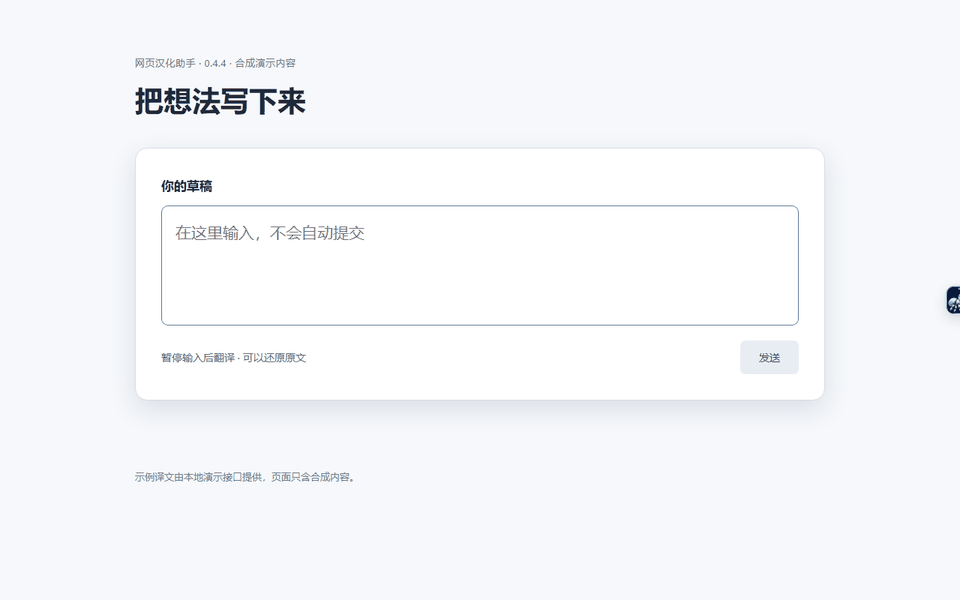

<h1 align="center">
  <br>
  网页汉化助手
</h1>
<p align="center">简体中文 · <a href="README.en.md">English</a></p>

<p align="center">
  用你自己的模型接口翻译网页和草稿<br>
  <sub>译文可以写回原网页或输入框。GitHub 和常用网站的界面还可通过本地词典汉化。</sub>
</p>

<p align="center">
  <a href="https://github.com/s-silt/web-chinese-translator/actions/workflows/ci.yml"></a>
  <a href="https://github.com/s-silt/web-chinese-translator/releases/latest">最新版本</a> &nbsp;·&nbsp; <a href="https://chromewebstore.google.com/detail/gbjmhoaejahffdnefecjfgkoifggpdhe">Chrome 应用商店</a> &nbsp;·&nbsp; Chrome（MV3）&nbsp;·&nbsp; <a href="LICENSE">MIT</a>
</p>

## 功能演示



[查看全部动图与截图](docs/DEMOS.md)
输入翻译在停输后直接替换；可从本地临时记录还原准确原稿。视频字幕翻译已移除。

| 核心能力 | 说明 |
| --- | --- |
| **网页翻译** | 接入 OpenAI 兼容接口（DeepSeek、OpenAI、Claude 或自建中继），整页或逐站自动翻译，滚动到哪翻到哪 |
| **阅读与输入** | 划词翻译与释义、聊天输入框和网页搜索框的草稿多语言互译 |
| **离线界面词典** | 26 组常用网站（Cursor、Claude、Vercel、Linear 等）和 GitHub 的菜单按钮直接本地替换，不调用模型 |
| **可控** | 总开关、排除本站、单页上限、运行范围名单；状态和失败原因写在弹出页上 |

```text
页面文字 ──► 已授权站点 + 已配置接口 ──► 你的模型接口 ──► 原位替换    按需发送
    │                    │
    │         敏感页跳过自动处理；排除站点禁用模型；无痕窗口不运行
    │
    └──► 界面词典（常用网站 / GitHub / 自定义）──► 原位替换        不联网
```

## 快速开始

1. 推荐在 Chrome 中从 [Chrome 应用商店](https://chromewebstore.google.com/detail/gbjmhoaejahffdnefecjfgkoifggpdhe) 安装，商店版自动更新。
2. [Releases](https://github.com/s-silt/web-chinese-translator/releases/latest) 仅提供 `web-chinese-translator-<版本>-chrome.crx` 与 `SHA256SUMS.txt` 校验和文件；CRX 仅适用于允许自行分发安装的环境（如企业策略、Linux 或开发调试环境，普通 Windows / macOS 正式版 Chrome 通常限制直接侧载 CRX），普通用户请通过 Chrome 应用商店安装。
3. 点弹出页「配置模型」或「模型设置」：选服务商预设，填 API Key 和模型名，点「保存并连接」。连接徽章显示延迟，失败时写明原因。
4. 打开支持的英文网页，点弹出页「翻译本页」。常去的网站可开启「本站自动翻译」。

| 任务 | 入口 |
| --- | --- |
| 翻译或恢复当前页 | 弹出页主按钮，或 `Alt+T` |
| 某个网站一直自动翻译 | 弹出页「本站自动翻译」 |
| 某个网站不调用模型 | 弹出页「排除本站」（本地词典仍生效） |
| 翻译选中文字 | 选中后右键「翻译选中文字」，或 `Alt+S` |
| 翻译输入框或搜索框草稿 | 设置页开启「输入翻译」并授权，停输达到设定时间后直接替换；可点「还原原文」，无需快捷键，不自动发送消息 |
| 翻译在线文档编辑区 | 开启「输入翻译」并授权，编辑停止后翻译；已支持且安全的纯文本直接替换，复杂格式仅预览和复制 |
| 粘贴任意文字或 Markdown | 弹出页或网页悬浮菜单的「文本翻译」，每次最多 6000 字符；复用现有模型配置，关闭窗口后不恢复草稿 |
| 长文翻到一半停住 | 设置页调高「单页翻译上限」，或点「继续翻译」 |
| 补充或改写界面词条 | 设置页「网站与词典」；GitHub 在「GitHub 规则」 |
| 完整说明 | [使用说明](docs/USAGE.md) |

Word 网页版与桌面版目前不支持原位回填，请使用文本翻译窗口粘贴处理。编辑器兼容性取决于具体版本与文档结构；还原前会比较当前内容，继续编辑后不会用旧译文记录覆盖新草稿。

## 默认行为与边界

- **模型翻译默认关闭。** 提供服务商地址预设，但需要自行配置接口与凭据；网页功能仅在你启用并授权的站点发送内容，文本窗口仅在你主动翻译输入或粘贴文字时发送；费用由你与服务方约定。
- **单页有上限。** 默认每页约 5 万字，可在设置页改为 2 万到 20 万或不限；达到后其余内容保留原文。
- **界面词典不联网。** 常用网站和 GitHub 的界面词条在本机替换；GitHub 词典另有简繁两套，详见 [使用说明](docs/USAGE.md#github-汉化)。
- **敏感页面跳过。** 账户、付款、邮件等页面不自动翻译，弹出页显示「已跳过」；识别是启发式的，不保证全覆盖。
- **API Key 明文存本机。** 存在扩展的 IndexedDB，与接口来源绑定，不随账号同步。
- **不处理。** 跨域 iframe、关闭的 Shadow DOM、图像字幕；无痕窗口中扩展不运行。

权限、数据与网络请求见 [隐私说明](docs/PRIVACY.md)。

## 开发

```bash
bun install
bun run lint && bun run compile && bun run check:parity && bun run check:locale && bun run test
bun run build      # 加载 .output/chrome-mv3
```

需要 Bun 1.3+、Node.js 22.13+。改词典先读 [术语表](docs/GLOSSARY.md)，简繁同步。其余见 [开发与发布](docs/DEVELOPMENT.md)。问题请提 [Issues](https://github.com/s-silt/web-chinese-translator/issues/new/choose)。

## 致谢与许可

术语参照 [GitHub 官方中文文档](https://docs.github.com/zh) 与 [Pro Git 中文版](https://git-scm.com/book/zh/v2)。[MIT](LICENSE) © 2026 github-chinese contributors、web-chinese-translator contributors；第三方许可见 [THIRD_PARTY_NOTICES.txt](public/THIRD_PARTY_NOTICES.txt)。
