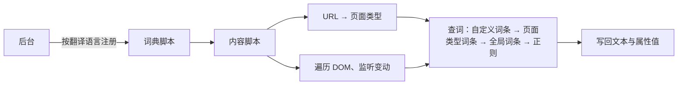

<div align="center">


# 网页汉化助手

把 GitHub 界面翻译成简体中文、繁体中文，并支持划词翻译与站点自动翻译的浏览器扩展。基于上游 [github-chinese](https://github.com/setube/github-chinese)（MIT）开发。

[](LICENSE)

<br />


[安装](#安装) · [功能](#功能) · [使用](#使用) · [工作原理](#工作原理) · [隐私与权限](#隐私与权限) · [参与贡献](#参与贡献)

</div>

---

在 github.com、gist.github.com、www.githubstatus.com 上把界面文字替换为简体中文或繁体中文，翻译在本地完成。

只翻译界面，不碰用户内容：自述文件、评论、代码、提交消息、存储库名、用户名、自定义标签名等保持原文。

| 英文界面      | 简体中文 | 繁體中文 |
| ------------- | -------- | -------- |
| Pull requests | 拉取请求 | 拉取請求 |
| Issues        | 议题     | 議題     |
| Actions       | 操作     | 動作     |
| Releases      | 发行版   | 發行版本 |
| Fork          | 复刻     | 分叉     |
| Star          | 星标     | 加星號   |

## 功能

### 翻译

- 简体、繁体两套词典，各 3 万余条，词条按页面类型（存储库、议题、拉取请求、操作、设置等）区分
- 繁体按台湾、香港、澳门用语从英文翻译，不是简繁转换；术语见[简体术语表](docs/GLOSSARY.md)、[繁体术语表](docs/GLOSSARY.zh-TW.md)
- 跟随 GitHub 的 React 渲染与页面切换实时翻译，文字被改写后自动重新翻译
- 属性（`aria-label`、`placeholder`、`title` 等）与标签页标题一并翻译
- 时间本地化：`<relative-time>` 按翻译语言显示为「3 天前」「2026 年 10 月 26 日」

### 控制

- 弹出页：总开关、当前页状态、排除此页、时间本地化、翻译标题、界面语言、翻译语言、外观
- 内置本地词表：26 个站点（涵盖 AI 开发、AI 与模型、云与部署、代码与包管理、设计与协作、社区与学习六分类，如 Devin、Cursor、Claude、Vercel、Linear 等）默认自动替换界面词条；词表按站点与目标语言（简体中文、繁體中文、日本語、한국어）按需加载；英文目标保留原文，自定义词典与模型翻译不受影响
- GitHub 页仍为原有简/繁独立引擎；新增站点译表与机械蚂蚁图标由本项目制作，第三方许可声明见 public/THIRD_PARTY_NOTICES.txt
- 选项页（弹出页「规则」）：排除路径、自定义词条（导入、导出）
- 翻译语言默认按浏览器语言识别（语言列表中第一个中文：台湾、香港、澳门及 Hant 为繁体；没有中文时按时区），可手动指定；切换后已打开的页面随即重译
- 扩展界面：简体中文、繁體中文、English、日本語、한국어，默认跟随浏览器界面语言
- 外观：自动（跟随系统）、浅色、深色

### 网页翻译

- **阅读辅助**：启用划词辅助后，在 HTTP/HTTPS 网页选中文字即可弹出小窗，由模型判断是否需要翻译、释义或解释。智能陪读还会参考近期阅读主题，并以可忽略的小提示提供帮助。右键「翻译选中文字」保留为手动入口。
- **界面词库**：26 个预置站点（涵盖 AI 开发、AI 与模型、云与部署、代码与包管理、设计与协作、社区与学习六分类，完整域名见 src/translation/dictionaries/metadata.json，如 devin.ai、cursor.com、claude.ai、vercel.com、linear.app 等）的菜单、按钮等常见界面文字用内置词典本地化（离线、不联网；可在设置页关闭单个词典）；站点子域访问权限由元数据逐一列出并在安装时声明。还可以在设置页新建、编辑、导入自定义词典，为其他站点添加本地词条。自定义词典只存本机，启用前需要对应网站的访问权限，词条只用于本地替换、不发送内容。
- **翻译目标语言**：模型翻译与固定词典支持简体中文、繁体中文、English、日本語、한국어（设置页选择，切换后已翻译页面自动重译）；GitHub 汉化引擎不受此影响，仍只支持简体、繁体。
- **站点自动翻译**：把页面上的可见英文文本翻译为中文。默认关闭；在设置页或弹出页逐站点开启时需明确同意并授予站点权限，文本才会发送给你自己配置的 OpenAI 兼容接口（可选自定义 Chat Completions 或自定义 Responses 两种协议，填到 `/v1` 或完整 `/chat/completions`、`/responses` 地址均可按所选协议派生请求地址；`http` 仅允许 localhost/127.0.0.1/[::1]；不支持原生 Gemini 等协议，请使用兼容中继）。
  1. 选择接口类型，填写接口地址和 API Key，点击"获取模型"选择模型或手动填写模型名；按需展开"高级设置"配置可选温度（0–2）、附加请求参数（JSON 对象）与自定义请求头（JSON 对象），保存并连接。
  2. 辅助模式选择关闭、划词辅助或智能陪读；智能陪读需确认额外的数据使用说明。
  3. 在扩展弹窗逐站开启自动翻译；「恢复本页原文」暂停本页替换，「继续翻译」恢复处理。
  密钥与自定义请求头均与接口来源（协议、主机、端口）绑定。同一来源下，密钥或请求头输入留空会保留已保存的值；自定义请求头填写 `{}` 并保存可清空；更换来源需重新填写对应密钥/请求头或显式删除/清空。
- API Key 与自定义请求头只保存在本机扩展的 IndexedDB 中，不随浏览器账号同步；单页自动翻译量有上限，可在弹出页恢复原文、继续或暂停。

## 安装

### 加载本项目构建包

从 [GitHub Releases](https://github.com/s-silt/web-chinese-translator/releases/latest) 下载最新版本。普通 Chrome 用户优先选择 `web-chinese-translator-<版本>-chrome.zip`，解压后按下表加载。

在本项目目录运行 `bun run build` 后，可直接加载 `.output/chrome-mv3`；运行 `bun run zip` 可生成 Chrome 安装包。模型翻译与阅读辅助属于本项目新增功能，参考项目的发行版仍对应原 GitHub 汉化扩展。

| 浏览器  | 文件                                | 安装                                                                                                                   |
| ------- | ----------------------------------- | ---------------------------------------------------------------------------------------------------------------------- |
| Chrome  | `web-chinese-translator-<版本>-chrome.zip`  | 解压 → `chrome://extensions` → 开启「开发者模式」→「加载已解压的扩展程序」→ 选择解压出的文件夹                         |
| Edge    | `web-chinese-translator-<版本>-edge.zip`    | 解压 → `edge://extensions` → 开启「开发人员模式」→「加载解压缩的扩展」→ 选择解压出的文件夹                             |
| Firefox | `web-chinese-translator-<版本>-firefox.zip` | 解压 → `about:debugging#/runtime/this-firefox` →「临时载入附加组件」→ 选择 `manifest.json`，重启后失效；仅 GitHub 汉化 |

更新已解压的扩展时，保持原目录路径，替换文件后在扩展管理页点击"重新加载"，再刷新网页。更换目录或改用 CRX 会改变扩展身份，原有配置不会自动迁移。

- `.crx` 用于企业策略部署；Chrome、Edge 一般不允许直接安装商店之外的 crx。
- 发布工作流另可生成已签名的 Firefox `.xpi`；带校验文件的发布包可运行 `sha256sum -c --ignore-missing SHA256SUMS.txt`。

### 从源码构建

环境：Bun 1.3+、Node.js 22.13+（LTS 版本）。

在本项目目录执行：

```bash
bun install
bun run build           # Chrome → .output/chrome-mv3
bun run build:edge      # Edge → .output/edge-mv3
bun run build:firefox   # Firefox → .output/firefox-mv3
```

加载方式同上表（不用解压）；Firefox 临时载入 `.output/firefox-mv3/manifest.json`。

## 使用

安装后立即生效，已打开的 GitHub 页面无需刷新。

### 弹出页状态

| 状态   | 含义                   | 按钮     |
| ------ | ---------------------- | -------- |
| 已翻译 | 当前页已翻译           | 排除此页 |
| 已排除 | 当前页命中排除规则     | 取消排除 |
| 已停用 | 总开关关闭             | —        |
| 未就绪 | 页面里的脚本未响应     | 刷新     |
| 未授权 | 站点权限已撤销         | 授权     |
| 不可用 | 当前页不是 GitHub 页面 | —        |

### 排除路径

每行一条，以 `/` 开头，不区分大小写；`*` 匹配一段，`**` 匹配任意多段；同时排除下级路径。

```text
/settings        设置页及其下级页面
/*/*/wiki        所有存储库的维基
```

### 自定义词条

原文 → 译文，优先于内置词条。导入、导出格式为 JSON：`{ "原文": "译文" }`；导入时同一原文以导入的为准。

## 工作原理



- **词典脚本**：每种翻译语言一个，只加载当前语言的。后台把它注册为 `document_start` 内容脚本，页面开始解析前就绪；未注册时（如刚安装）由内容脚本动态导入，Firefox 请后台注入。
- **与 React 共存**：只改文本节点的内容与属性值，不增删、替换节点；React 重渲染写回英文时，以新内容为原文重新翻译。
- **跳过用户内容**：用户内容、代码所在的区域整体跳过。
- **时间本地化**：`<relative-time>` 等时间元素按翻译语言渲染，再补中文与数字间的空格、去掉时区名。

## 浏览器支持

| 浏览器          | 版本                    |
| --------------- | ----------------------- |
| Chrome、Edge    | 支持 Manifest V3 的版本 |
| Firefox         | 140+                    |
| Firefox Android | 142+                    |

## 隐私与权限

Chrome、Edge 提供固定词库、模型翻译和阅读辅助；Firefox 版本仅启用 GitHub 本地汉化，不运行模型与阅读辅助。固定词库匹配与替换在本地完成，不调用模型。划词辅助会发送选中文字、附近可见上下文，以及当前页的标题、主标题和站点名；自动翻译仅处理你明确开启的站点；智能陪读还会发送候选段落，并可能附带其他标签页和网站的近期阅读线索（`storage.session`，最多 12 条、30 分钟过期、每次最多 4 条）。停留、回读次数与操作方式不发送给模型。已保存的 API Key 随每次模型请求（含连接测试）以 `Authorization: Bearer` 发往你配置的 OpenAI 兼容接口，本机 IndexedDB 明文保存、与接口来源绑定、不随账号同步。常见账户、密钥、付款、邮件等敏感页面（含哈希路由与私有网络地址）不发送文字或记录线索，仅显式右键菜单可发送所选文字；在「不调用模型的网站」中列出的域名及其子域名完全禁止模型发送与线索记录，本地词库仍可用。扩展在无痕窗口中不运行。修改排除列表会清除既有线索；清理失败会提示，发送前仍会过滤排除网站和可识别高敏主机的旧线索。识别为启发式，不保证覆盖全部隐私页面。详见[隐私说明](docs/PRIVACY.md)。

| 权限                                                                                  | 用途                                                                                                                                                                              |
| ------------------------------------------------------------------------------------- | --------------------------------------------------------------------------------------------------------------------------------------------------------------------------------- |
| `storage`                                                                             | 保存设置（`storage.sync`）、自定义词条与翻译配置（`storage.local`）                                                                                                               |
| `https://github.com/*`、`https://gist.github.com/*`、`https://www.githubstatus.com/*` | 在这三个站点运行内容脚本，翻译页面界面                                                                                                                                            |
| 26 个站点的 HTTPS 域名（完整列表见 [站点元数据](src/translation/dictionaries/metadata.json)） | 在预置站点及其子域运行界面词库脚本，可在设置页逐个关闭；GitHub 系列域名权限单独保留 |
| `scripting`                                                                           | 按当前语言注册词典脚本，页面开始解析前就绪；词典脚本动态加载失败（Firefox 不动态加载）时由后台注入；Chrome、Edge 安装、更新后向已打开的标签页注入脚本（Firefox 自动注入）          |
| `activeTab`                                                                           | 点右键菜单「翻译本页」、「翻译选中文字」或点弹出页操作时，临时向当前页注入翻译面板脚本                                                                                            |
| `contextMenus`                                                                        | 注册「翻译本页」与「翻译选中文字」右键菜单                                                                                                                                        |
| `optional_host_permissions`（`https://*/*`、`http://*/*`）                            | 模型接口与自动翻译站点分别按来源授权。开启划词辅助需授权 HTTP/HTTPS 网站访问，并注册相应页面脚本；撤销权限后停止相应处理                                                            |

- `alarms`（仅 Chrome、Edge）：用于清理过期的短期阅读线索。
- 不申请 `tabs`、`history` 权限。划词辅助关闭时，不注册全站点划词脚本。Firefox 中可在附加组件管理器撤销站点权限。
- 停用、排除、改自定义词条、改时间本地化开关、扩展更新或卸载时，以及 GitHub 从自身缓存写回译文时（前进后退、帧导航到带锚点的地址），可能重新请求当前 GitHub 页面（条件见隐私说明）；点弹出页「刷新」时重新加载当前页。
- 设置存 `storage.sync`，可能随浏览器账号同步；自定义词条与翻译配置存 `storage.local`；API Key 存本机 IndexedDB（`web-translator-secrets`），不同步、未加密。

## 参与贡献

- 网页翻译与阅读辅助问题请在[本项目反馈](https://github.com/s-silt/web-chinese-translator/issues/new/choose)；上游 GitHub 词库问题也可在[上游仓库](https://github.com/setube/github-chinese/issues/new/choose)反馈。
- 改进译文：先读[术语表](docs/GLOSSARY.md)；改动简体词典后同步繁体。
- 提交前运行以下检查（同[发布工作流](.github/workflows/release.yml)）：

```bash
bun run lint
bun run compile
bun run check:parity
bun run check:locale
bun run check:locale --locale=zh-TW
bun run test
```

### 常用命令

| 命令                                                        | 说明                                                                               |
| ----------------------------------------------------------- | ---------------------------------------------------------------------------------- |
| `bun run dev`、`dev:edge`、`dev:firefox`                    | 开发模式，修改后自动重载                                                           |
| `bun run build`、`build:edge`、`build:firefox`、`build:all` | 构建到 `.output/<浏览器>-mv3/`                                                     |
| `bun run zip`、`zip:edge`、`zip:firefox`、`zip:all`         | 打包 zip 到 `.output/`（Firefox 另出源码包）                                       |
| `bun run pack:crx`                                          | 由 zip 打包 crx                                                                    |
| `bun run test`、`test:watch`、`coverage`                    | 单元测试（Vitest）、监听模式、覆盖率                                               |
| `bun run test:e2e`、`test:e2e:live`                         | 端到端测试（Playwright）、线上冒烟，均先构建                                       |
| `bun run compile`、`lint`、`lint:firefox`、`format`         | 类型检查（vue-tsc）、ESLint、web-ext lint、Prettier                                |
| `bun run check:locale`、`check:parity`                      | 词典自检、简繁对照                                                                 |
| `bun run harvest`、`coverage:locale`                        | 采集界面文本、统计词典覆盖率                                                       |
| `bun run icons`                                             | 由 `assets/icon.svg` 生成 `public/icon/*.png`（内嵌位图超过 512px 时先压缩并写回） |

`bun test`、`bun build` 是 Bun 自带命令，本项目脚本一律用 `bun run`。

<details>
<summary><b>词典维护</b></summary>

1. 先读[术语表](docs/GLOSSARY.md)：翻译原则、格式、术语表、词典写法。术语参照 GitHub 官方中文文档与 Pro Git 中文版；社区词库 [maboloshi/github-chinese](https://github.com/maboloshi/github-chinese)（GPL-3.0）只用于发现漏收的原文，不搬运译文。
2. 简体词典在 `src/locales/zh-CN/`，繁体词典在 `src/locales/zh-TW/`（同名文件、同键同结构，译文按[繁体术语表](docs/GLOSSARY.zh-TW.md)从英文翻译），按页面类型分文件（`static` / `scoped` / `regexp` / `ignore` / `attributeRules` / `inline` / `mergeText`，字段说明见 `src/core/types.ts`），由 `index.ts` 注册。较大的组拆成子目录 `<组>/<名>.ts`，由 `<组>.ts` 用 `mergeDictionaries` 合并；子目录里没有默认导出的模块是共用工具。
3. 自检：`bun run check:locale src/locales/zh-CN/<文件>.ts`；不带文件时检查全部词典（含子文件），另查 static 冲突、同一页面类型的 scoped 冲突、未合并的子文件、未注册的主文件；加 `--redundant` 列出可删的 scoped（全局 static 已有相同译文）。繁体加 `--locale=zh-TW`（给出 `src/locales/zh-TW/` 下的文件时可省略），另扫描源码里所有含中文的字符串与模板字面量（含替换函数、模块内常量、helpers.ts 与 `src/locales/shared/`；注释与抛出的错误信息除外）：简体字报错，大陆用语与弯引号警告。改动简体词典后同步繁体，`bun run check:parity [文件...]` 逐项对照两边的键、正则、属性规则、行内句、导出与注册顺序。
4. 采集界面文本：`bun run harvest [--areas issues,pulls]`，按 `scripts/harvest-urls.json` 访问公开页面（未登录），输出 `.harvest/raw/<区域>.json`。访问要克制，避免触发限流。
5. 统计覆盖率：`bun run coverage:locale [--raw <目录>]... [--all] [--unused]`，输出 `.harvest/digest/<区域>.txt`（未翻译文本，按出现页面数排序）与 `coverage.json`；页面类型按当前路由规则重新判断，相邻文本节点与引擎一样先整组匹配、未命中再逐段统计（需用新版 harvest 采集的数据）。`--unused` 另输出 `unused.txt`：采集页面上从未用到的词条，可能已过时，删除前人工核对。
6. 正则规则写单元测试：`tests/unit/locales/<区域>.test.ts`。

</details>

<details>
<summary><b>测试</b></summary>

```bash
bun run test            # 单元测试（Vitest）
bun run coverage        # 单元测试覆盖率
bun run test:e2e        # 构建后运行端到端测试（Playwright 加载 .output/chrome-mv3）
bun run test:e2e:live   # 线上冒烟：访问 github.com/vuejs/core，截图存 test-results/
```

端到端测试首次运行前安装浏览器：`bunx playwright install chromium`。

- 离线测试：`github.com` 请求由 `tests/e2e/fixtures/` 中仿 GitHub 结构的页面应答，覆盖界面翻译、用户内容保持原文、属性、动态插入与 React 改写、忽略区域内的界面块（评论中的建议块、应用权限选择器）、`<relative-time>`、标题、设置联动（总开关、排除路径、自定义词条，含后台休眠后）、弹出页。
- 线上冒烟仅在环境变量 `E2E_LIVE=1` 时执行。`bun run test:e2e:live` 从 `tests/e2e/live.env` 读取环境变量，该文件不入库：首次运行前把 `tests/e2e/live.env.example` 复制为 `tests/e2e/live.env`，并将 `E2E_LIVE` 改为 `1`。
- 报告：`playwright-report/`；失败时的 trace 与截图：`test-results/`。

</details>

<details>
<summary><b>目录结构</b></summary>

```text
.github/                 议题模板、发布工作流
assets/icon.svg          图标源文件
docs/GLOSSARY.md         翻译规范与术语表
docs/GLOSSARY.zh-TW.md   繁体翻译规范与术语表
docs/PRIVACY.md          隐私说明
public/_locales/         扩展名称、说明的多语言文本
public/icon/             扩展图标（bun run icons 生成）
scripts/                 采集、覆盖率、词典校验、图标渲染、crx 打包脚本
src/
  core/                  匹配器、URL → 页面类型、忽略规则、翻译引擎
  locales/zh-CN/         简体中文词典
  locales/zh-TW/         繁体中文词典（与简体同结构）
  locales/shared/        简繁共用的时间、拼接工具
  i18n/                  扩展界面文案（简体、繁体、英文）
  shared/                设置存储、消息协议等共用模块
  components/            弹出页与选项页共用组件
  components/ui/         基础控件：按钮（含水波纹）、输入框、多行输入框、下拉框、开关
  entrypoints/           background、content、词典脚本、popup、options
tests/
  unit/                  单元测试
  e2e/                   端到端测试与离线夹具
wxt.config.ts            WXT 配置与 manifest
```

</details>

## 发布

推送标记 `v<版本>`（与 `package.json` 的 `version` 一致）后，[发布工作流](.github/workflows/release.yml)依次检查（lint、类型、词典、单元测试）、打包，并发布 GitHub 发行版（先建草稿，产物传完后发布）；版本号带 `-`（如 `v1.0.0-beta.1`）时为预发行版。在存储库的「操作」页手动运行时只检查、打包，产物在运行记录的工件里。

| 产物                                                | 说明                                                    |
| --------------------------------------------------- | ------------------------------------------------------- |
| `github-chinese-<版本>-chrome.zip`、`-edge.zip`     | Chrome、Edge 扩展包（上架商店用）                       |
| `github-chinese-<版本>-firefox.zip`、`-sources.zip` | Firefox 扩展包、源码包（AMO 审核用）                    |
| `github-chinese-<版本>-chrome.crx`、`-edge.crx`     | CRX3 扩展包                                             |
| `github-chinese-<版本>-firefox.xpi`                 | Firefox 扩展包                                          |
| `SHA256SUMS.txt`                                    | 以上文件的 SHA-256，校验：`sha256sum -c SHA256SUMS.txt` |

<details>
<summary><b>存储库机密与签名</b></summary>

| 机密                               | 用途                                                                                                     | 未配置时                     |
| ---------------------------------- | -------------------------------------------------------------------------------------------------------- | ---------------------------- |
| `CRX_PRIVATE_KEY`                  | crx 签名私钥（RSA PEM），决定扩展 ID                                                                     | 停止发布，需配置固定私钥     |
| `AMO_JWT_ISSUER`、`AMO_JWT_SECRET` | [AMO API 密钥](https://addons.mozilla.org/developers/addon/api/key/)，以自行分发（unlisted）方式签名 xpi | xpi 未签名                   |

- 生成私钥：`openssl genpkey -algorithm RSA -pkeyopt rsa_keygen_bits:2048 -out crx-key.pem`，文件内容填入 `CRX_PRIVATE_KEY`。私钥不提交到存储库（`.gitignore` 已忽略 `*.pem`）；更换私钥后扩展 ID 随之改变。
- 本地打包 crx：`bun run pack:crx --key crx-key.pem .output/web-chinese-translator-<版本>-chrome.zip`，在 zip 旁生成同名 `.crx`；不带 `--key` 时读环境变量 `CRX_PRIVATE_KEY`。
- xpi 只在推送正式版标记时签名；手动运行、预发行版（Firefox 的版本号去掉 `-` 之后的部分，签名会占用正式版的版本号）产出未签名 xpi。
- AMO 上同一版本号只能提交一次：签名包下载后立即存进发行版草稿，重跑时沿用；以 unlisted 签名过的版本，不能再以同一版本号上架（listed）。

</details>

## 常见问题

### 有些文字没有翻译？

用户内容不翻译。界面文字未翻译时，用「翻译问题」模板反馈。

网页自动翻译不进入跨域 iframe 与关闭的 Shadow DOM。

### 繁体是简繁转换吗？

不是。繁体词典按台湾、香港、澳门用语从英文翻译，见[繁体术语表](docs/GLOSSARY.zh-TW.md)。

### 只在部分页面关闭？

弹出页「排除此页」，或在选项页设置排除路径。

## 致谢

- 术语参照 [GitHub 官方中文文档](https://docs.github.com/zh)与 [Pro Git 中文版](https://git-scm.com/book/zh/v2)
- [maboloshi/github-chinese](https://github.com/maboloshi/github-chinese)：用于发现漏收的原文，不搬运译文
- 基于 [WXT](https://wxt.dev)、[Vue](https://vuejs.org) 构建

## 许可证

[MIT](LICENSE) © 2026 github-chinese contributors

打包产物中包含的第三方运行时包及其许可证文本见 [public/THIRD_PARTY_NOTICES.txt](public/THIRD_PARTY_NOTICES.txt)。

## LINUX DO社区

感谢[Linux.do](https://linux.do/)社区的支持。
