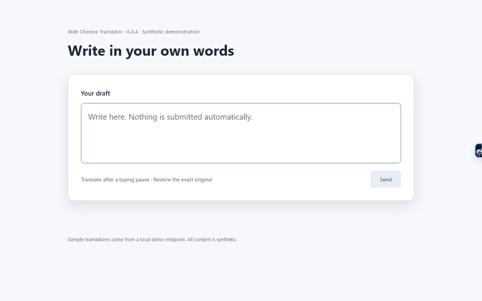
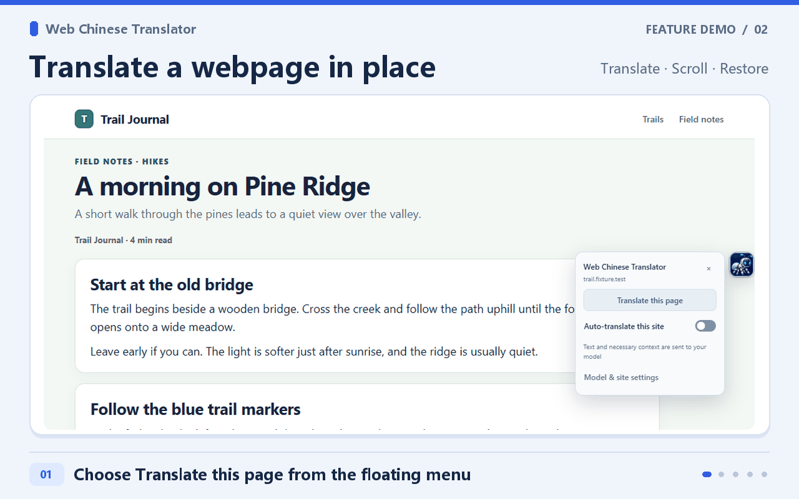
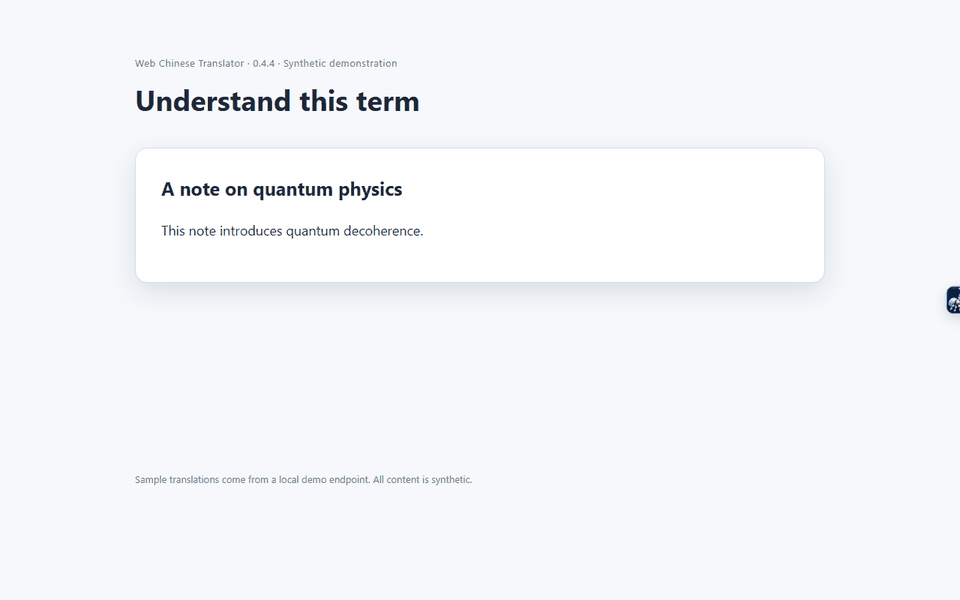
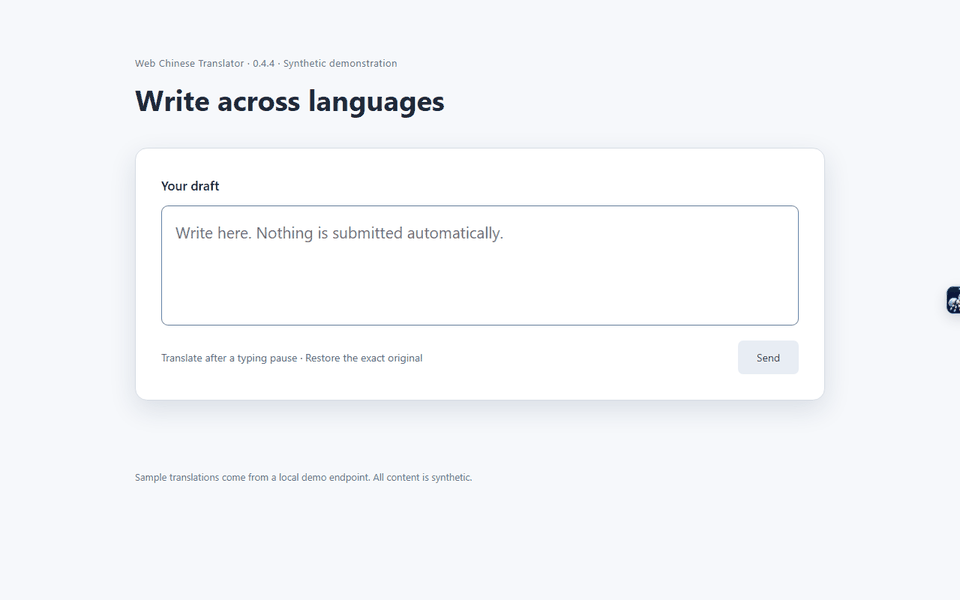
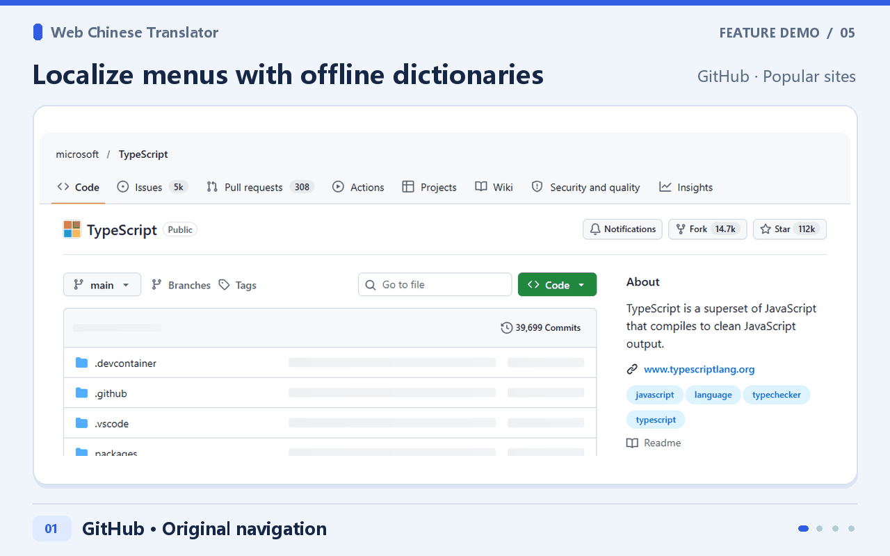
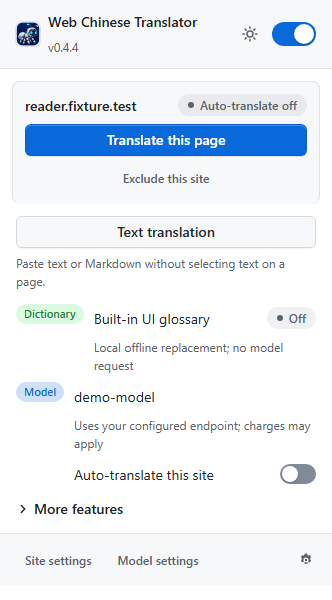
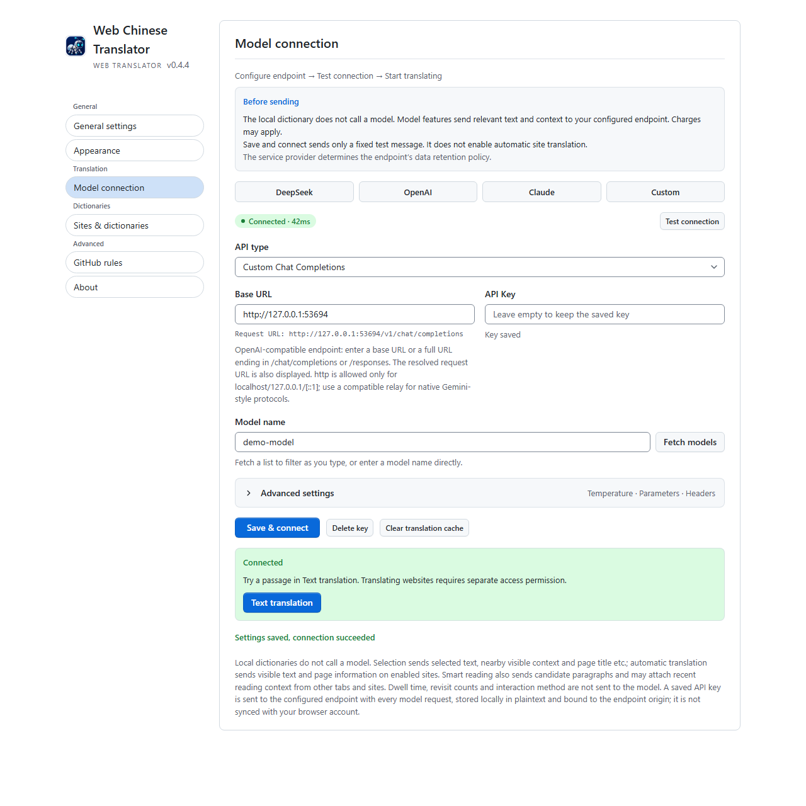

# Feature demos

[Back to README](../README.en.md) · [简体中文](DEMOS.md) · [Usage guide in Chinese](USAGE.md)

## Draft translation

Enable Input translation to replace a comment draft or web search query after the configured typing pause. Restore original recovers the exact draft saved temporarily in local memory. Editing, changing targets or closing the panel invalidates the record. You still choose when to submit.

## Webpage translation

Translate the page from the floating menu. Visible text continues to translate as you scroll, and you can restore the original. Enable automatic translation for sites you visit often.

## Selected text

Select a sentence to see a translation next to it. Video subtitle translation has been removed.

## Multilingual drafts

The demo auto-detects Arabic, French, and Swahili drafts and translates them into Chinese. Choose a different target language in settings.

## Offline interface dictionaries

Translate menus and buttons on GitHub and Hacker News with local dictionaries. This works without a model endpoint.

## Extension popup

The GIFs and screenshots show the v0.4.4 extension running on synthetic pages. The translations come from a local demo endpoint. Results depend on the model you configure.
