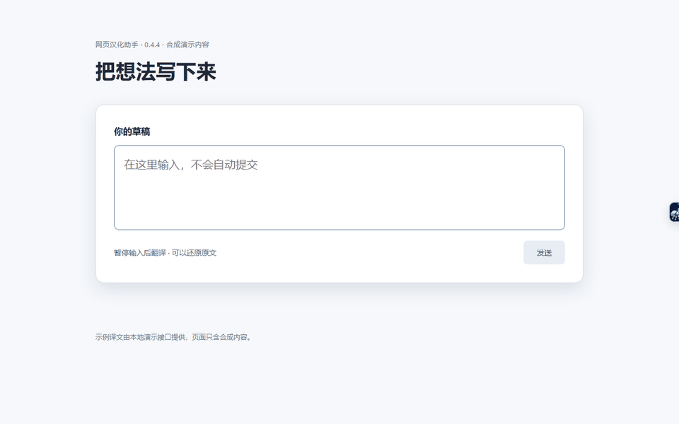
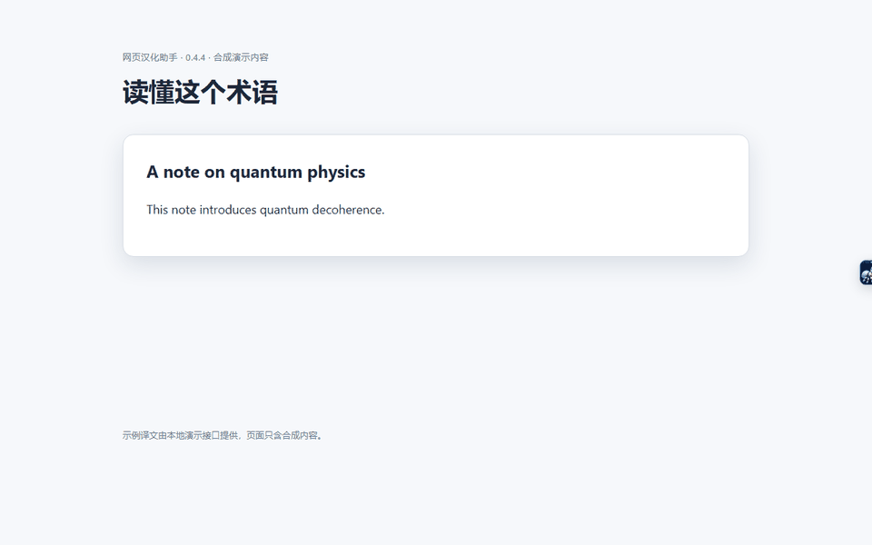
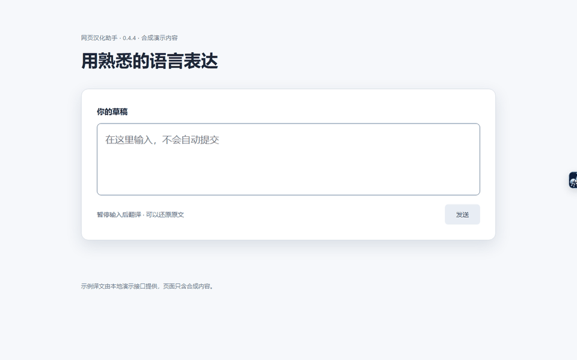
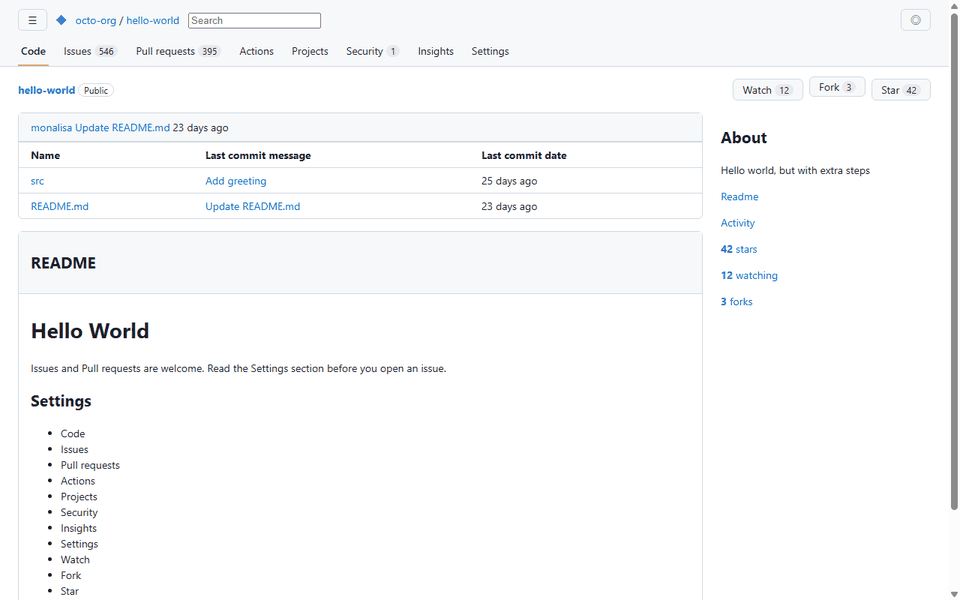
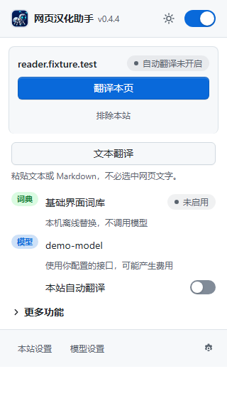

# 功能演示

[返回 README](../README.md) · [English](DEMOS.en.md) · [使用说明](USAGE.md)

## 草稿翻译

开启输入翻译，在评论框或网页搜索框输入草稿，停止输入达到设定时间后直接替换。可点「还原原文」恢复本地内存暂存的准确原稿；继续编辑、切换目标或关闭面板后旧记录失效。提交仍由你操作。

## 网页翻译

从悬浮入口翻译本页。往下滚动时继续处理可见文字，读完可恢复原文。常访问的网站可单独开启自动翻译。

## 划词翻译

选中文句后在原文旁查看译文。视频字幕翻译已移除。

## 多语言输入

演示中，阿拉伯语、法语和斯瓦希里语草稿自动检测后译成中文。目标语言可在设置页切换。

## 本地界面词典

本地词典替换 GitHub 和 Hacker News 的菜单与按钮。它可以在未配置模型时使用。

## 扩展弹出页

动图和截图录自 v0.4.4 的实际扩展界面，页面仅含合成内容。示例译文来自本地演示接口，实际译文取决于所配置的模型。
