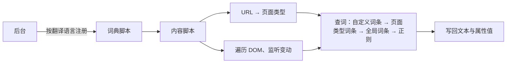

# 使用说明

本文由 README 移出并按新界面更新。隐私与权限见 [PRIVACY.md](PRIVACY.md)，开发见 [DEVELOPMENT.md](DEVELOPMENT.md)。

## 弹出页


| 区域 | 内容 |
| --- | --- |
| 顶栏 | 扩展总开关；经典与毛玻璃风格另有外观按钮（自动 → 浅色 → 深色） |
| 状态卡 | 当前站点和状态徽章；主按钮随状态切换为「翻译本页」「恢复本页原文」「继续翻译」，执行中显示「正在处理…」；「排除本站」把当前域名加入「不调用模型的网站」 |
| 失败段 | 有失败段时显示数量。模型翻译在本页运行时可「全部重试」；暂停时点「继续翻译」一并重试；达到段数上限时只能恢复原文 |
| 词典行 | 本地词典：GitHub 页面显示 GitHub 汉化状态（已翻译 / 已排除 / 未就绪 → 刷新 / 未授权 → 授权），其他网站显示内置或自定义词典是否作用于本页 |
| 模型行 | 已配置时显示模型名与「本站自动翻译」开关；未配置时显示「1 分钟完成配置」 |
| 更多功能 | 自动弹窗、网页悬浮入口、视频字幕翻译、输入翻译；展开状态会记住。开关不可用时下方写明原因 |
| 底栏 | 「本站设置」「模型设置」直达设置页对应分区，齿轮打开设置页 |

敏感页面（账户、支付、邮件等，启发式识别）状态徽章显示「已跳过」，不发送文字。

## 模型配置


1. 打开设置页「翻译 → 模型连接」。点服务商预设（DeepSeek、OpenAI、Claude）只填接口地址；「自定义」清空地址并聚焦输入框。预设不填模型名，也不改已保存的密钥。
2. 填写 API Key，点「获取模型」选择或手动填写模型名；按需展开「高级设置」配置温度（0–2）、附加请求参数与自定义请求头（JSON 对象）。
3. 点「保存并连接」：保存后自动发送一条固定测试文本，连接徽章显示结果。之后可随时点「测试连接」（有未保存改动时需先保存）。

| 徽章 | 含义 |
| --- | --- |
| 未配置 | 接口地址或模型名为空 |
| 未测试 | 已配置，本次打开设置页后尚未测试 |
| 已连接 · N ms | 测试成功，显示往返延迟 |
| 密钥无效 | 接口返回鉴权失败 |
| 连接超时 | 请求或排队超时 |
| 无法连接 | 网络错误或后台连接中断，检查接口地址 |
| 地址或模型不存在 | 接口返回 404 |
| 请求过于频繁 | 接口返回 429 |
| 其他 | 显示接口返回的错误原文 |

仅支持 OpenAI 兼容的 Chat Completions 与 Responses 协议；原生 Gemini 等协议请使用兼容中继。`http` 接口仅允许 localhost/127.0.0.1/[::1]。密钥与自定义请求头和接口来源（协议、主机、端口）绑定，留空保留已保存的值；更换来源需重新填写。

## 设置页导航

| 分组 | 分区 |
| --- | --- |
| 常规 | 常用设置、外观 |
| 翻译 | 模型连接 |
| 词典 | 网站与词典、GitHub 规则 |
| 高级 | 关于 |

Firefox 构建只有 GitHub 规则与关于。

## 快捷键

Chrome、Edge 默认：`Alt+T` 切换本页翻译，`Alt+S` 翻译选中文字，`Alt+Y`（macOS `Command+Shift+Y`）翻译输入框草稿。在设置页「快捷键」或浏览器扩展快捷键页修改。

## 功能明细

### 翻译

- 简体、繁体两套词典，各 3 万余条，词条按页面类型（存储库、议题、拉取请求、操作、设置等）区分
- 繁体按台湾、香港、澳门用语从英文翻译，不是简繁转换；术语见[简体术语表](GLOSSARY.md)、[繁体术语表](GLOSSARY.zh-TW.md)
- 跟随 GitHub 的 React 渲染与页面切换实时翻译，文字被改写后自动重新翻译
- 属性（`aria-label`、`placeholder`、`title` 等）与标签页标题一并翻译
- 时间本地化：`<relative-time>` 按翻译语言显示为「3 天前」「2026 年 10 月 26 日」

### 控制

- 弹出页：见上文「弹出页」；时间本地化、翻译标题、界面语言、翻译语言在设置页「GitHub 规则」
- 内置本地词表：26 个站点（涵盖 AI 开发、AI 与模型、云与部署、代码与包管理、设计与协作、社区与学习六分类，如 Devin、Cursor、Claude、Vercel、Linear 等）默认自动替换界面词条；词表按站点与目标语言（简体中文、繁體中文、日本語、한국어）按需加载；英文目标保留原文，自定义词典与模型翻译不受影响
- GitHub 页仍为原有简/繁独立引擎；新增站点译表与机械蚂蚁图标由本项目制作，第三方许可声明见 public/THIRD_PARTY_NOTICES.txt
- 设置页「GitHub 规则」：排除路径、自定义词条（导入、导出）
- 翻译语言默认按浏览器语言识别（语言列表中第一个中文：台湾、香港、澳门及 Hant 为繁体；没有中文时按时区），可手动指定；切换后已打开的页面随即重译
- 扩展界面：简体中文、繁體中文、English、日本語、한국어，默认跟随浏览器界面语言
- 外观：自动（跟随系统）、浅色、深色

### 网页翻译

- **阅读辅助**：启用划词辅助后，在 HTTP/HTTPS 网页选中文字即可弹出小窗，由模型判断是否需要翻译、释义或解释。智能陪读还会参考近期阅读主题，并以可忽略的小提示提供帮助。右键「翻译选中文字」保留为手动入口。
- **自动弹窗**：关闭后不再自动显示划词、陪读和后台状态提示（失败、暂停与上限）；手动调用、固定词典和网页原位翻译仍可使用。蚂蚁悬浮入口有独立的显示开关。
- **界面词库**：26 个预置站点（涵盖 AI 开发、AI 与模型、云与部署、代码与包管理、设计与协作、社区与学习六分类，完整域名见 src/translation/dictionaries/metadata.json，如 devin.ai、cursor.com、claude.ai、vercel.com、linear.app 等）的菜单、按钮等常见界面文字用内置词典本地化（离线、不联网；可在设置页关闭单个词典）；站点子域访问权限由元数据逐一列出并在安装时声明。还可以在设置页新建、编辑、导入自定义词典，为其他站点添加本地词条。自定义词典只存本机，启用前需要对应网站的访问权限，词条只用于本地替换、不发送内容。
- **翻译目标语言**：模型翻译与固定词典支持简体中文、繁体中文、English、日本語、한국어（设置页选择，切换后已翻译页面自动重译）；GitHub 汉化引擎不受此影响，仍只支持简体、繁体。
- **站点自动翻译**：把页面上的可见英文文本翻译为中文。默认关闭；在设置页或弹出页逐站点开启，按浏览器提示授予站点权限。开启后，页面可见英文文本及标题等必要上下文会发送给你自己配置的 OpenAI 兼容接口（数据使用说明显示在操作界面中；可选自定义 Chat Completions 或自定义 Responses 两种协议，填到 `/v1` 或完整 `/chat/completions`、`/responses` 地址均可按所选协议派生请求地址；`http` 仅允许 localhost/127.0.0.1/[::1]；不支持原生 Gemini 等协议，请使用兼容中继）。
  1. 选择接口类型，填写接口地址和 API Key，点击"获取模型"选择模型或手动填写模型名；按需展开"高级设置"配置可选温度（0–2）、附加请求参数（JSON 对象）与自定义请求头（JSON 对象），保存并连接。
  2. 辅助模式选择关闭、划词辅助或智能陪读，按浏览器提示授予网站访问权限；界面内说明所选模式会发送的文字、上下文及短期阅读线索。
  3. 在扩展弹窗逐站开启自动翻译；「恢复本页原文」暂停本页替换，「继续翻译」恢复处理。
  密钥与自定义请求头均与接口来源（协议、主机、端口）绑定。同一来源下，密钥或请求头输入留空会保留已保存的值；自定义请求头填写 `{}` 并保存可清空；更换来源需重新填写对应密钥/请求头或显式删除/清空。
- API Key 与自定义请求头只保存在本机扩展的 IndexedDB 中，不随浏览器账号同步；单页自动翻译量有上限，可在弹出页恢复原文、继续或暂停。

## GitHub 汉化

安装后立即生效，已打开的 GitHub 页面无需刷新。

### 排除路径

每行一条，以 `/` 开头，不区分大小写；`*` 匹配一段，`**` 匹配任意多段；同时排除下级路径。

```text
/settings        设置页及其下级页面
/*/*/wiki        所有存储库的维基
```

### 自定义词条

原文 → 译文，优先于内置词条。导入、导出格式为 JSON：`{ "原文": "译文" }`；导入时同一原文以导入的为准。

## 工作原理



- **词典脚本**：每种翻译语言一个，只加载当前语言的。后台把它注册为 `document_start` 内容脚本，页面开始解析前就绪；未注册时（如刚安装）由内容脚本动态导入，Firefox 请后台注入。
- **与 React 共存**：只改文本节点的内容与属性值，不增删、替换节点；React 重渲染写回英文时，以新内容为原文重新翻译。
- **跳过用户内容**：用户内容、代码所在的区域整体跳过。
- **时间本地化**：`<relative-time>` 等时间元素按翻译语言渲染，再补中文与数字间的空格、去掉时区名。

## 常见问题

### 有些文字没有翻译？

用户内容不翻译。界面文字未翻译时，用「翻译问题」模板反馈。

网页自动翻译不进入跨域 iframe 与关闭的 Shadow DOM。

### 繁体是简繁转换吗？

不是。繁体词典按台湾、香港、澳门用语从英文翻译，见[繁体术语表](GLOSSARY.zh-TW.md)。

### 只在部分页面关闭？

在设置页「GitHub 规则」设置排除路径；其他网站在弹出页点「排除本站」停用模型翻译（本地词典仍生效）。
