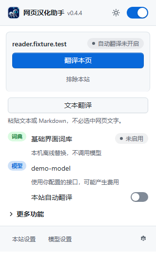
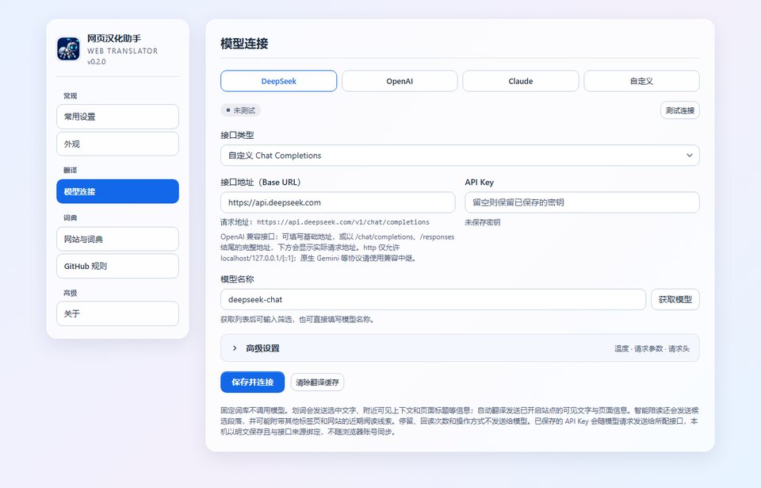
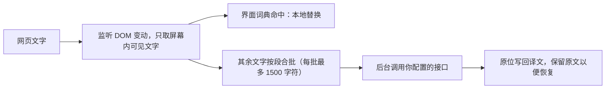

# 使用说明

本文由 README 移出并按新界面更新。隐私与权限见 [PRIVACY.md](PRIVACY.md)，开发见 [DEVELOPMENT.md](DEVELOPMENT.md)。

## 弹出页



| 区域 | 内容 |
| --- | --- |
| 顶栏 | 扩展总开关；经典与毛玻璃风格另有外观按钮（自动 → 浅色 → 深色） |
| 状态卡 | 当前站点和状态徽章；主按钮随状态切换为「翻译本页」「恢复本页原文」「继续翻译」，执行中显示「正在处理…」；「排除本站」把当前域名加入「不调用模型的网站」 |
| 进度 | 模型翻译运行、暂停或达到上限时显示本页已用字数 / 单页上限（不限时只显示已用）、已译段数和正在翻译的段数，弹出页打开期间每 1.5 秒刷新 |
| 失败段 | 有失败段时显示数量。模型翻译在本页运行时可「全部重试」；暂停时点「继续翻译」一并重试；达到段数上限时只能恢复原文 |
| 词典行 | 本地词典：GitHub 页面显示 GitHub 汉化状态（已翻译 / 已排除 / 未就绪 → 刷新 / 未授权 → 授权），其他网站显示内置或自定义词典是否作用于本页 |
| 模型行 | 已配置时显示模型名与「本站自动翻译」开关；未配置时显示「1 分钟完成配置」 |
| 更多功能 | 自动弹窗、网页悬浮入口、视频字幕翻译、输入翻译；展开状态会记住。开关不可用时下方写明原因 |
| 底栏 | 「本站设置」「模型设置」直达设置页对应分区，齿轮打开设置页 |

敏感页面（账户、支付、邮件等，启发式识别）状态徽章显示「已跳过」，不发送文字。

## 模型配置



1. 打开设置页「翻译 → 模型连接」。点服务商预设（DeepSeek、OpenAI、Claude）只填接口地址；「自定义」清空地址并聚焦输入框。预设不填模型名，也不改已保存的密钥。
2. 填写 API Key，点「获取模型」选择或手动填写模型名；按需展开「高级设置」配置温度（0–2）、附加请求参数与自定义请求头（JSON 对象）。
3. 点「保存并连接」：保存后自动发送一条固定测试文本，连接徽章显示结果。之后可随时点「测试连接」（有未保存改动时需先保存）。

| 徽章 | 含义 |
| --- | --- |
| 未配置 | 接口地址或模型名为空 |
| 未测试 | 已配置，本次打开设置页后尚未测试 |
| 已连接 · N ms | 测试成功，显示往返延迟 |
| 密钥无效 | 接口返回鉴权失败 |
| 连接超时 | 请求或排队超时 |
| 无法连接 | 网络错误或后台连接中断，检查接口地址 |
| 地址或模型不存在 | 接口返回 404 |
| 请求过于频繁 | 接口返回 429 |
| 其他 | 显示接口返回的错误原文 |

仅支持 OpenAI 兼容的 Chat Completions 与 Responses 协议；原生 Gemini 等协议请使用兼容中继。`http` 接口仅允许 localhost/127.0.0.1/[::1]。密钥与自定义请求头和接口来源（协议、主机、端口）绑定，留空保留已保存的值；更换来源需重新填写。

## 设置页导航

| 分组 | 分区 |
| --- | --- |
| 常规 | 常用设置、外观 |
| 翻译 | 模型连接 |
| 词典 | 网站与词典、GitHub 规则 |
| 高级 | 关于 |

Firefox 构建只有 GitHub 规则与关于。

## 快捷键

Chrome、Edge 默认：`Alt+T` 切换本页翻译，`Alt+S` 翻译选中文字，`Alt+Y`（macOS `Command+Shift+Y`）翻译输入框或搜索框草稿。在设置页「快捷键」或浏览器扩展快捷键页修改。

## 网页翻译

- **整页与站点自动翻译**：弹出页「翻译本页」只翻当前页；「本站自动翻译」让该网站之后每次打开都自动翻译。只翻屏幕上看得到的文字，滚动到哪翻到哪。页面上的可见文字和标题等必要上下文会发给你配置的接口。
- **单页上限**：每页最多发送的字符数，默认约 5 万字，可在设置页「常用设置 → 单页翻译上限」改为约 2、10、20 万字或不限。达到上限后其余内容保留原文，弹出页写明原因；点「继续翻译」再追加一份。调高上限后已停住的页面会自动继续。
- **追加的文字**：网站在已译文字后面接着出现的原文（诗歌逐句出现、聊天回复逐字输出）只翻新增部分，已译部分不重发。
- **划词与阅读辅助**：开启划词辅助后，选中文字弹出小窗，由模型判断是翻译、释义还是解释；智能陪读还会参考近期阅读主题。右键「翻译选中文字」随时可用。
- **视频字幕**：YouTube、Netflix 文字字幕和标准网页字幕轨道，日文或英文译成中文。
- **输入翻译**：聊天框、评论框和网页搜索框（`type="search"`）里的中文草稿译成所选外文，出预览后按 Tab 或点「替换」。网址、邮箱、数字、密码等输入框不处理。浏览器自己的地址栏不属于网页，扩展无法读取或改写。
- **自动弹窗**：关闭后不再自动显示划词、陪读和后台状态提示；手动调用和网页原位翻译仍可使用。蚂蚁悬浮入口有独立开关。
- **目标语言**：简体中文、繁体中文、English、日本語、한국어，切换后已翻译页面自动重译。

接口与密钥：仅支持 OpenAI 兼容的 Chat Completions 和 Responses；填到 `/v1` 或完整地址均可。密钥与自定义请求头和接口来源绑定，只存本机 IndexedDB，不随账号同步。

## 界面词典

不调用模型，离线替换菜单、按钮等界面文字。

- **常用网站**：26 组预置站点（AI 开发、AI 与模型、云与部署、代码与包管理、设计与协作、社区与学习，完整域名见 `src/translation/dictionaries/metadata.json`），按目标语言加载，可在设置页「网站与词典」逐个关闭。
- **自定义词典**：为其他网站添加本地词条，只存本机。
- **GitHub**：见下文。

## GitHub 汉化

GitHub 用独立的简体、繁体词典（各 3 万余条，按页面类型匹配），繁体按台港澳用语从英文翻译，术语见 [简体术语表](GLOSSARY.md)、[繁体术语表](GLOSSARY.zh-TW.md)。界面属性、标签页标题和相对时间一并翻译；评论、代码、提交消息等用户内容保持原文。时间本地化、翻译标题、词典语言、排除路径和自定义词条在设置页「GitHub 规则」。Firefox 版只提供这一项。
### 排除路径

每行一条，以 `/` 开头，不区分大小写；`*` 匹配一段，`**` 匹配任意多段；同时排除下级路径。

```text
/settings        设置页及其下级页面
/*/*/wiki        所有存储库的维基
```

规则框下方的「测试网址」可填 GitHub 网址或以 `/` 开头的路径，按规则框当前内容（含未保存的修改）显示命中哪条规则。

### 自定义词条

原文 → 译文，优先于内置词条。导入、导出格式为 JSON：`{ "原文": "译文" }`。导入时先显示预览：新增、覆盖（译文不同）和与现有相同的条数及明细，点「确认导入」后同一原文以导入的为准，「只导入新增」保留已有译文，「取消」不写入。

## 工作原理



- **只改文字，不动结构**：只替换文本节点的内容与属性值，不增删节点；网站重新渲染写回原文时按新内容重译，在已译文字后接着追加原文时只译新增部分。
- **失败处理**：超时或返回条数不对时拆小重发；单段多次失败只放弃这一段并保留原文，连续失败会暂停本页，点「继续翻译」恢复。
- **跳过的内容**：代码、可编辑区域、隐藏元素、敏感页面和排除网站。
- **GitHub**：用独立的规则引擎按页面类型查词，不经过模型。

## 常见问题

### 长文翻到一半就不翻了？

达到了单页上限。弹出页会显示「已达本页上限」，点「继续翻译」追加一份，或在设置页调高「单页翻译上限」（调高后自动继续）。如果弹出页显示的是错误或暂停，看提示里的原因，常见的是密钥无效、接口超时或请求过于频繁。

### 有些文字没有翻译？

已经是中文的文字、代码、输入框内容不翻。网页自动翻译不进入跨域 iframe 与关闭的 Shadow DOM。GitHub 界面文字未翻译时，用「翻译问题」模板反馈。

### 能翻译浏览器地址栏吗？

不能。地址栏属于浏览器，扩展读不到也改不了。网页里的搜索框可以用「输入翻译」把中文草稿译成外文。

### 只在部分页面关闭？

其他网站在弹出页点「排除本站」停用模型翻译（界面词典仍生效）；GitHub 在设置页「GitHub 规则」设置排除路径。

### 繁体是简繁转换吗？

不是。繁体词典按台湾、香港、澳门用语从英文翻译，见 [繁体术语表](GLOSSARY.zh-TW.md)。
